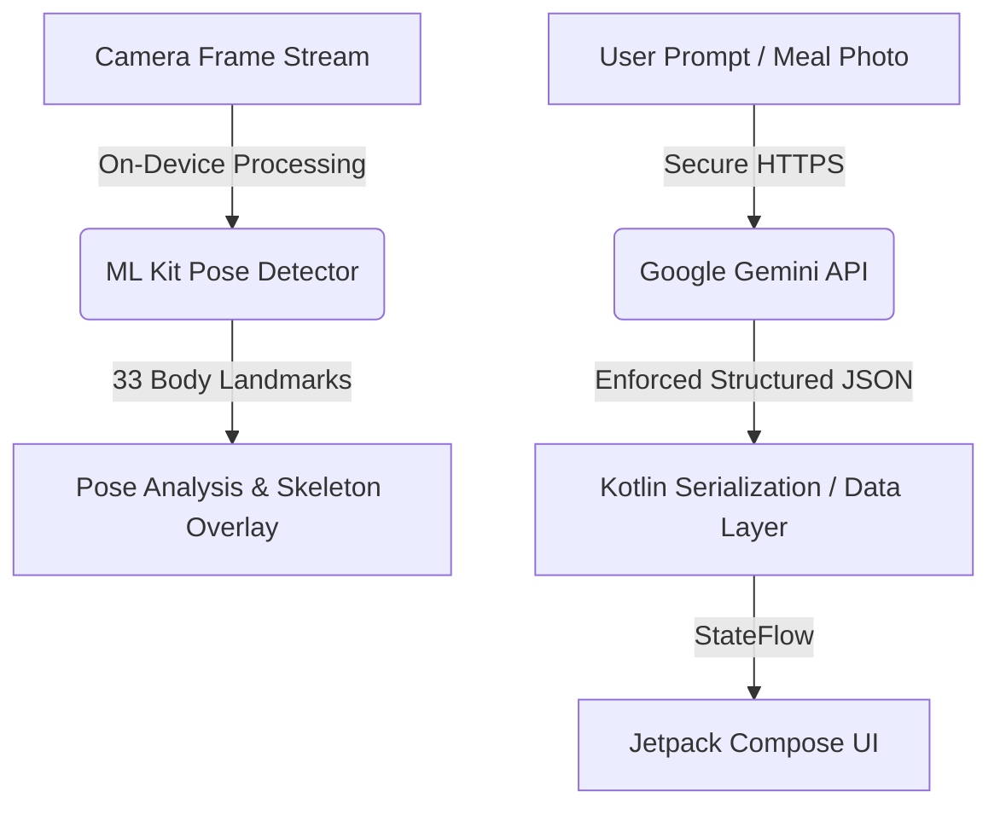

<div align="center">

  # ⚡ Kinetiq

  ### *Next-Gen AI-Powered Fitness, Real-Time Pose Tracking & Health Ecosystem for Android*

  [](https://developer.android.com/)
  [](https://kotlinlang.org/)
  [](https://developer.android.com/jetpack/compose)
  [](https://ai.google.dev/)
  [](https://developers.google.com/ml-kit/vision/pose-detection)
  [-blue?style=for-the-badge)](https://developer.android.com/)
  [-00C853?style=for-the-badge)](https://developer.android.com/)
  [](LICENSE)

</div>

---

## 📌 Executive Summary

**Kinetiq** is a cutting-edge native Android health and fitness ecosystem that seamlessly merges **Generative AI** with **On-Device Computer Vision**. Powered by Google's **Gemini 1.5 API** and **ML Kit Accurate Pose Detection**, Kinetiq transforms any Android smartphone into an intelligent personal fitness coach, automated nutritionist, and biomechanical posture analysis system.

Designed adhering to modern **Android Architecture Components**, **Clean Architecture**, and **Material Design 3**, Kinetiq delivers ultra-low latency, full data privacy for camera processing, and adaptive UI layouts across phones and tablets.

---

## ✨ Key Features

### 🤖 1. AI Fitness & Health Coach
- **Personalized Conversational AI:** Powered by Google's Gemini LLM with custom prompt engineering.
- **Dynamic Workout Plans:** Generates tailored routines based on user goals, available equipment, and fitness levels.
- **Structured JSON Output Engine:** Guarantees robust API response parsing into Kotlin state flows without runtime crashes.

### 🧘 2. Real-Time On-Device Pose Tracking
- **Computer Vision Analysis:** Integrates **Google ML Kit Pose Detection** to track 33 body keypoints in real time.
- **Privacy-First Architecture:** Video streams are processed 100% on-device; camera feeds are never stored or transmitted.
- **Biomechanical Feedback:** Tracks exercise form, rep counting, and joint alignment directly over a live camera preview overlay.

### 🥗 3. Multimodal Vision Meal Scanner
- **Photo-to-Nutrition Analysis:** Snap a picture of any meal to instantly receive estimated calorie counts, macro breakdowns (Protein, Carbs, Fats), and micronutrient summaries via Gemini Vision.
- **Dietary Insights:** Contextual tips and health score ratings for logged meals.

### 🍲 4. Smart AI Recipe Generator
- **Ingredient-Based Cooking:** Generates healthy, step-by-step recipes based on what ingredients users have in their pantry.
- **Custom Filters:** Supports vegan, keto, high-protein, calorie-restricted, and allergen-friendly filters.

### 📊 5. Health Connect Sync & Analytics
- **Android Health Connect Integration:** Bi-directional sync for daily steps, active calories burned, heart rate, and exercise telemetry.
- **Unified Health Dashboard:** Interactive charts, streak tracking, and gamified progress milestones.

### 🏆 6. Gamification & Workout Management
- **Streak & XP System:** Earn rewards and level up by completing daily fitness goals and logging meals.
- **Local & Cloud Sync:** Room local caching backed by Firebase Auth & Cloud Firestore for seamless cross-device synchronization.

---

## 🛠️ Tech Stack & Architecture

Kinetiq follows **Clean Architecture** principles and the **MVVM (Model-View-ViewModel)** pattern with Unidirectional Data Flow (UDF).

```
┌─────────────────────────────────────────────────────────┐
│                      UI Layer                           │
│        Jetpack Compose | Material 3 | Navigation        │
└────────────────────────────┬────────────────────────────┘
                             │ (StateFlow / Events)
┌────────────────────────────▼────────────────────────────┐
│                    ViewModel Layer                      │
│             Coroutines | State Management               │
└────────────────────────────┬────────────────────────────┘
                             │
┌────────────────────────────▼────────────────────────────┐
│                   Domain / Use Cases                    │
│          Business Logic & Repository Interfaces         │
└────────────────────────────┬────────────────────────────┘
                             │
 ┌───────────────────────────┴───────────────────────────┐
 │                       Data Layer                      │
 ├──────────────────┬──────────────────┬─────────────────┤
 │    Room Database │   Gemini AI API  │ ML Kit Vision   │
 │   & HealthPrefs  │   (Generative)   │ (Pose Tracking) │
 └──────────────────┴──────────────────┴─────────────────┘
```

| Layer | Technology Used |
|---|---|
| **Language** | 100% Idiomatic Kotlin 2.0 |
| **UI Framework** | Jetpack Compose, Material Design 3, Compose Navigation |
| **Generative AI** | Google Gemini 1.5 Flash/Pro API |
| **Computer Vision** | Google ML Kit Accurate Pose Detection (CameraX Integration) |
| **Local Persistence** | Room Database (SQLite), SharedPreferences / EncryptedPrefs |
| **Remote Backend** | Firebase Authentication, Cloud Firestore |
| **Health Telemetry** | Android Health Connect (`androidx.health.connect`) |
| **Asynchronous** | Kotlin Coroutines & `StateFlow` / `SharedFlow` |
| **Dependency Injection** | Hilt / Manual DI architecture |

---

## 🧠 AI & Machine Learning Methodology



### 1. Dataset Used
* **Generative AI:** The app uses Google's pre-trained Gemini 1.5 foundational model. No static training dataset was collected or stored. Input queries and image prompts are processed on-the-fly at runtime.
* **Computer Vision:** Biomechanical tracking uses Google's ML Kit Pose Detection pre-trained on high-accuracy human pose datasets. Live camera feeds are processed entirely on-device to ensure user privacy.

### 2. Training & Validation Approach
* **Prompt Engineering & Schema Enforcement:** Rather than custom model training, system prompts were engineered to strictly enforce JSON schemas for consistent UI rendering.
* **Validation Strategy:** Evaluated via functional and manual testing across physical Android hardware and Android Studio Emulators, verifying camera latency, UI adaptability across screen sizes, and JSON parsing reliability.

---

## 📂 Project Structure

```
com.utsav.kinetiq/
├── data/
│   ├── health/           # HealthConnectManager integration
│   ├── local/            # Room Database, DAOs, Entities, Preferences
│   └── remote/           # GeminiRepository, Firebase Auth & Firestore
├── domain/
│   ├── model/            # Workout, Recipe, UserProfile, ActivityLog models
│   └── repository/       # Repository interfaces
├── navigation/           # NavHost & NavDestinations
├── ui/
│   ├── auth/             # Login & Sign-Up screens
│   ├── coach/            # AI Coach Screen & ViewModel
│   ├── home/             # Dashboard, Motivational Cards, HomeViewModel
│   ├── main/             # Main scaffold & bottom navigation
│   ├── nutrition/        # MealScannerScreen & MealScannerViewModel
│   ├── onboarding/       # User Onboarding flow
│   ├── plans/            # Specialized fitness plans showcase
│   ├── profile/          # Profile Setup, Settings, User stats
│   ├── recipe/           # Recipe Generator & Detail screens
│   ├── theme/            # Material 3 Color palette, Typography, Theme
│   └── vision/           # ML Kit PoseDetectorProcessor, CameraPreview
└── MainActivity.kt       # Single-activity entry point
```

---

## 🚀 Getting Started

### Prerequisites
- **Android Studio:** Studio Ladybug (2024.2.1) or newer
- **JDK:** Java 17 or higher
- **Android Device / Emulator:** Running API level 26 (Android 8.0) or higher
- **Gemini API Key:** Obtain an API key from [Google AI Studio](https://aistudio.google.com/)

### Installation & Setup

1. **Clone the Repository:**
   ```bash
   git clone https://github.com/UtsavChoudhary25/KinetIQ.git
   cd KinetIQ
   ```

2. **Configure API Keys:**
   Create or edit the `local.properties` file in the root directory and add your Gemini API Key:
   ```properties
   GEMINI_API_KEY="YOUR_GEMINI_API_KEY_HERE"
   ```

3. **Build the Application:**
   Open the project in **Android Studio**, sync the Gradle project, and run on a connected physical device or emulator:
   ```bash
   ./gradlew assembleDebug
   ```

---

## 🔒 Privacy & Security

- 🔒 **Zero Camera Cloud Upload:** All pose detection and camera analysis happen locally on the user's device via ML Kit.
- 🔑 **API Security:** API keys are injected at build time and excluded from version control.
- 🩺 **Health Data Protection:** Health Connect permissions are requested granularly and accessed strictly within user-approved scopes.

---

## 📄 License

This project is released under the **MIT License**. See the [LICENSE](LICENSE) file for more information.

---

<div align="center">
  <sub>Built with ❤️ using Kotlin & Jetpack Compose</sub>
</div>
